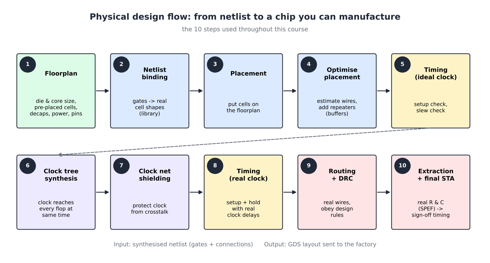

# Day 01 — Floor-Planning Steps

> **Course:** Section 1: Physical Design Flow Overview &nbsp;|&nbsp; **Lecture 1** &nbsp;|&nbsp; [VLSI Academy — Physical Design Flow (Udemy)](https://www.udemy.com/course/vlsi-academy-physical-design-flow/)  
> **Notes source:** your handwritten notes + the lecture topic

## The big idea in one line

After synthesis we have a **netlist** — a list of gates (AND, OR, flip-flops …) and how they are connected. **Physical design** turns that list into a real **drawing of the chip** (layout) that a factory can make.

Think of it like building a house:

- the **netlist** is the list of rooms and which rooms connect,
- **physical design** is drawing the actual floor plan: where each room goes, where the pipes and wires run.

The course goes through 10 steps. Day 01–05 is a quick tour of all of them; the later days explain each one in detail.

## Step 1: Floorplanning — the first and most important step

Floorplanning decides the **shape and layout of the chip before any small cell is placed**. From your notes, floorplanning has these sub-steps:

| # | Sub-step | Simple meaning |
|---|---|---|
| 1 | **Define the width and height of the core and die** | decide how big the chip is |
| 2 | **Define the location of pre-placed cells** | put the big ready-made blocks (memories, adders, IPs) first, based on how they **connect** |
| 3 | **Surround pre-placed cells with decoupling capacitors** | give each big block a small local "battery" so its voltage stays steady |
| 4 | **Power planning** | build a grid of power (VDD) and ground (VSS) wires across the chip |
| 5 | **Pin placement** | decide where the input/output pins sit on the edge of the chip |
| 6 | **Logical cell placement blockage** | mark areas (near the pins) where **no logic cell may be placed** |

### Core vs die

- **Die**: the whole small rectangle of silicon that is cut out of the wafer.
- **Core**: the inner area of the die where the logic actually sits. The ring between core and die is used for the pins and I/O.

### Pre-placed cells (preview)

**Pre-placed cells** are blocks with a fixed job, such as an **adder, a memory, a multiplexer**. They are placed **by the designer** and their location is chosen **based on connectivity** — blocks that talk to each other a lot are put close together.

### Example

Imagine a small chip with a memory, an adder and 2,000 small gates:

1. Choose the core size so all cells fit with some free space.
2. Put the memory in one corner and the adder next to it (they exchange data).
3. Put decoupling capacitors around both.
4. Draw the power grid.
5. Put the data-input pins on the side near the memory, the output pins near the adder.
6. Block a ring near the pins so no gate is squeezed there.

Only **after** this does the tool place the 2,000 small gates.

## Key points

- Physical design = netlist → real layout.
- Floorplanning sets the stage: chip size, big blocks, decaps, power, pins, blockages.
- A bad floorplan cannot be fixed later by the tool — it is the foundation.

## Practice Questions

1. What is the input and the output of physical design?
2. List the six sub-steps of floorplanning.
3. What is the difference between the core and the die?
4. On what basis are pre-placed cells positioned?

**Answers**

1. Input: the synthesised netlist. Output: the layout (GDS) that is sent to the factory.
2. Core/die size, pre-placed cells, decoupling capacitors, power planning, pin placement, placement blockage.
3. The die is the whole piece of silicon; the core is the inner area where the logic cells are placed.
4. On connectivity — blocks that communicate are placed near each other.

---
[Index](../README.md) | [Day 02 ➡](../Day-02-Netlist-Binding-and-Placement-Optimization/README.md)
