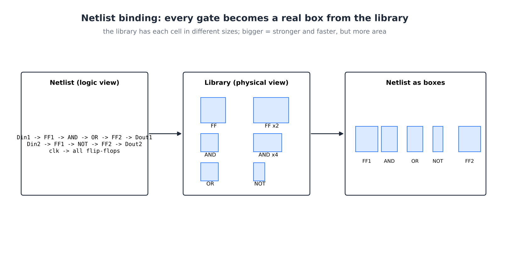
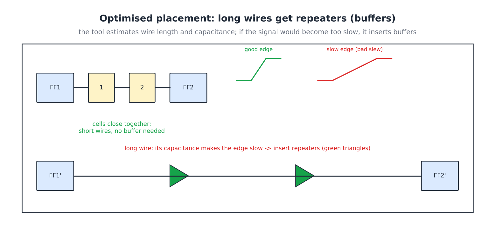

# Day 02 — Netlist Binding and Placement Optimization

> **Course:** Section 1: Physical Design Flow Overview &nbsp;|&nbsp; **Lecture 2** &nbsp;|&nbsp; [VLSI Academy — Physical Design Flow (Udemy)](https://www.udemy.com/course/vlsi-academy-physical-design-flow/)  
> **Notes source:** your handwritten notes + the lecture topic

## Step 2: Bind the netlist with physical cells

In the netlist, a gate is only a **name and a function** ("this is an AND gate"). It has no size yet.

**Binding** means: for every gate, pick a **real cell from the library** — a box with an actual **width and height**.



From your notes (the Step 1 sketch): the circuit has inputs **Din1, Din2, Din3, Din4**, clocks **Clk1, Clk2**, flip-flops **FF1 → gates 1, 2 → FF2**, and outputs **Dout1 … Dout4**, plus **Block a, Block b, Block c**. After binding, each of these becomes a rectangle, so the whole netlist is now a set of boxes:

```
FF1 | 1 | 2 | FF2        <- one path, now as physical boxes
FF1 | 1 | 2 | FF2
FF1 | 1 | 2 | FF2
FF1 | 1 | 2 | FF2
[Block a] [Block b]
[    Block c     ]
```

**The library** is like a catalogue: it has every cell in different sizes (a small AND gate and a big, stronger AND gate). The tool picks the one that fits the job.

## Step 3: Placement

Now the boxes are placed **on the floorplan**:

- the pre-placed blocks are already fixed,
- the remaining cells are placed **close to the pins and the cells they connect to** (e.g. FF1 near Din1, FF2 near Dout1),
- the goal is **short wires**.

## Step 4: Optimise placement

Even with good placement, some connections are long (e.g. a flip-flop near the left pins must talk to one near the right pins).

At this stage we **estimate the wire length and its capacitance** and, based on that, **insert repeaters** (buffers).

**Why?** A long wire is like a long, thin water pipe: the signal arrives **weak and slow**. A repeater **re-drives** the signal so it stays sharp — "to keep the signal intact" (your notes).



## Key points

- Binding: gate name → real cell with size, from the library.
- Placement: put cells near the pins/cells they connect to.
- Optimisation: estimate wires, add repeaters so the signal stays clean.

## Practice Questions

1. What does "binding the netlist with physical cells" mean?
2. What is a cell library?
3. Why are repeaters added on long wires?

**Answers**

1. Replacing each logical gate in the netlist with a real cell (a box with width and height) from the library.
2. A collection of ready-made cells (gates, flip-flops) in different sizes, each with its shape and timing data.
3. A long wire has high capacitance, so the signal becomes slow and weak; a repeater re-drives it to keep it intact.

---
[⬅ Day 01](../Day-01-Floor-Planning-Steps/README.md) | [Index](../README.md) | [Day 03 ➡](../Day-03-Placement-Timing-and-Clock-Tree-Synthesis/README.md)
