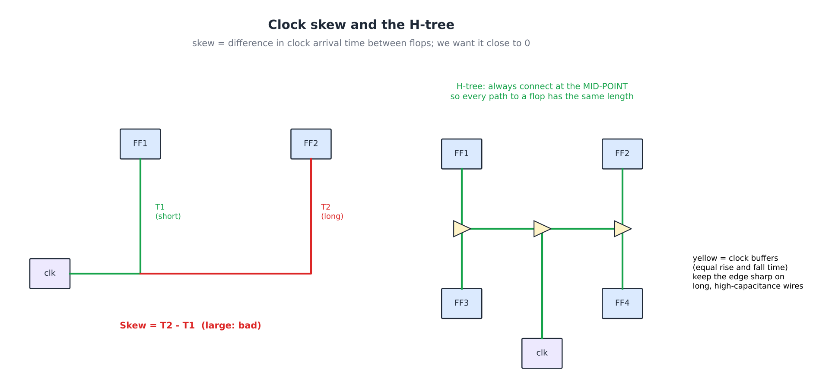

# Day 03 — Placement Timing and Clock Tree Synthesis

> **Course:** Section 1: Physical Design Flow Overview &nbsp;|&nbsp; **Lecture 3** &nbsp;|&nbsp; [VLSI Academy — Physical Design Flow (Udemy)](https://www.udemy.com/course/vlsi-academy-physical-design-flow/)  
> **Notes source:** your handwritten notes + the lecture topic

## Step 5: Timing analysis with an ideal clock

Once the cells are placed we can check if the chip will be **fast enough**. At this stage we pretend the clock is **ideal** — it reaches every flip-flop at exactly the same moment (there are no clock buffers yet).

From your notes: **trace the data path and check the slew**.

- **Data path**: launch flip-flop → gates → capture flip-flop. Add up all delays (cell delays + estimated wire delays) and check that the total, **θ (theta)**, is less than the clock period minus a small margin.
- **Slew**: how sharp each signal edge is. If an edge is too slow, buffers are added.

**Example:** clock = 1 GHz → period T = 1 ns. If the path delay θ is 0.9 ns and the flip-flop needs 0.15 ns of setup margin, 0.9 > 0.85 → **too slow**; the cells must be moved closer, resized or buffered.

(Full details: Days 14–18.)

## Step 6: Clock tree synthesis (CTS)

Until now the clock was "ideal". In reality the clock is **one signal that must reach thousands of flip-flops** through wires.

**Clock tree synthesis** builds the clock wiring as a **tree with buffers**, so that the clock reaches every required flip-flop:

- **at (almost) the same time** — the difference is called **skew** and should be close to 0,
- **with a sharp edge** — buffers keep it strong.

From your notes: *clock tree analysis to see if the clock is reaching the required flip-flops.*

(Full details: Day 19.)

## Key points

- First timing check uses an ideal clock: data path delay θ must fit inside the clock period.
- Check the **slew** too.
- CTS builds a buffered clock tree so the clock reaches all flops at the same time.

## Practice Questions

1. What does "ideal clock" mean?
2. What two things are checked in the first timing analysis?
3. What is the goal of clock tree synthesis?

**Answers**

1. The clock reaches every flip-flop at the same moment with no delay (no clock buffers or wires yet).
2. The data-path delay (setup) and the slew (transition) of the signals.
3. To deliver the clock to every flip-flop at nearly the same time (low skew) with sharp edges.

---
[⬅ Day 02](../Day-02-Netlist-Binding-and-Placement-Optimization/README.md) | [Index](../README.md) | [Day 04 ➡](../Day-04-Clock-Net-Shielding/README.md)
