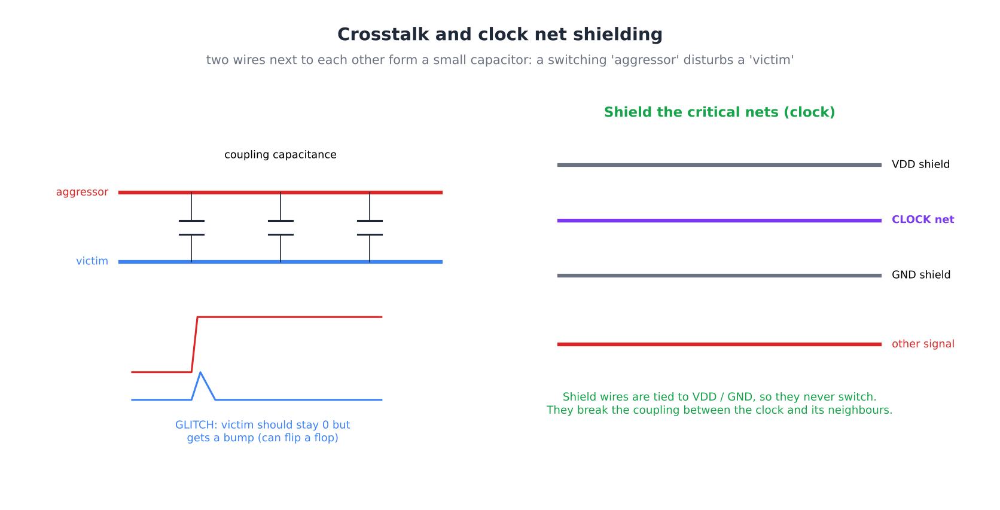

# Day 04 — Clock Net Shielding

> **Course:** Section 1: Physical Design Flow Overview &nbsp;|&nbsp; **Lecture 4** &nbsp;|&nbsp; [VLSI Academy — Physical Design Flow (Udemy)](https://www.udemy.com/course/vlsi-academy-physical-design-flow/)  
> **Notes source:** your handwritten notes + the lecture topic

## Step 7: Clock net shielding

The clock is the **most important signal** in the chip: every flip-flop depends on it. If its timing is disturbed, the whole chip can fail.

**Problem — crosstalk:** wires that run next to each other behave like a tiny capacitor. When one wire switches, it can **disturb** its neighbour:

- a **glitch** — a small unwanted pulse on a wire that should be steady,
- a **delta delay** — the neighbour's edge arrives earlier or later than expected.

**Solution — shielding** (your notes): *we protect the clock net from outside; shielding protects it from crosstalk.* We put **shield wires** on both sides of the clock wire. The shields are connected to **VDD or GND**, so they **never switch** — they can't disturb the clock, and they block disturbances coming from other wires.

**Analogy:** the clock wire is a person talking on the phone; noisy neighbours (other wires) make it hard to hear. Shielding is like putting soundproof walls on both sides.

## Step 8: Timing analysis with the real clock

After CTS and shielding, the clock has **real delays** through its buffers and wires. Timing is checked again, now including these clock delays (setup **and** hold). (Full details: Days 21–23.)

## Key points

- Crosstalk = coupling between neighbouring wires → glitches and delay changes.
- The clock net is shielded with VDD/GND wires, which never switch.
- After CTS, timing is re-checked with the real clock.

## Practice Questions

1. Why is the clock net treated specially?
2. What is crosstalk?
3. Why are shield wires tied to VDD or GND?

**Answers**

1. Every flip-flop depends on it; a disturbance on the clock can break the whole chip.
2. Unwanted coupling between neighbouring wires, causing glitches or delay changes.
3. Wires tied to VDD/GND never switch, so they don't create noise and they block coupling from other wires.

---
[⬅ Day 03](../Day-03-Placement-Timing-and-Clock-Tree-Synthesis/README.md) | [Index](../README.md) | [Day 05 ➡](../Day-05-Route-DRC-Clean-Parasitics-Extraction-Final-STA/README.md)
