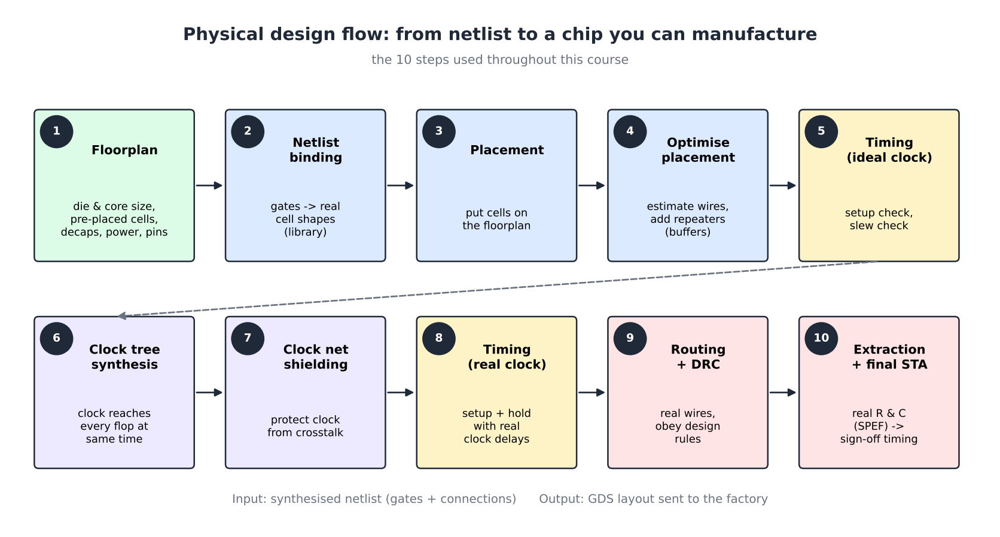

# Physical Design Flow — Day-by-Day Notes 🧩

Day-by-day study notes for the course **VLSI Academy — Physical Design Flow** (Udemy, 30 lectures in 7 sections), written by **Pavitinder Singh Bahia** (ECE, Thapar Institute of Engineering & Technology) from my own handwritten notes.

Every day = one lecture, explained in simple language with diagrams, worked examples and practice questions (with answers).

> 🎓 Course: https://www.udemy.com/course/vlsi-academy-physical-design-flow/



## 📚 Contents

| Day | Section | Topic |
|---|---|---|
| 01 | 1 · Physical Design Flow Overview | [Floor-Planning Steps](Day-01-Floor-Planning-Steps/README.md) |
| 02 | 1 · Physical Design Flow Overview | [Netlist Binding and Placement Optimization](Day-02-Netlist-Binding-and-Placement-Optimization/README.md) |
| 03 | 1 · Physical Design Flow Overview | [Placement Timing and Clock Tree Synthesis](Day-03-Placement-Timing-and-Clock-Tree-Synthesis/README.md) |
| 04 | 1 · Physical Design Flow Overview | [Clock Net Shielding](Day-04-Clock-Net-Shielding/README.md) |
| 05 | 1 · Physical Design Flow Overview | [Route, DRC Clean, Parasitics Extraction, Final STA](Day-05-Route-DRC-Clean-Parasitics-Extraction-Final-STA/README.md) |
| 06 | 2 · Floorplanning | [Utilization Factor and Aspect Ratio](Day-06-Utilization-Factor-and-Aspect-Ratio/README.md) |
| 07 | 2 · Floorplanning | [Concept of Pre-Placed Cells](Day-07-Concept-of-Pre-Placed-Cells/README.md) |
| 08 | 2 · Floorplanning | [De-coupling Capacitors](Day-08-De-coupling-Capacitors/README.md) |
| 09 | 2 · Floorplanning | [Power Planning](Day-09-Power-Planning/README.md) |
| 10 | 2 · Floorplanning | [Pin Placement and Logical Cell Placement Blockage](Day-10-Pin-Placement-and-Logical-Cell-Placement-Blockage/README.md) |
| 11 | 3 · Placement | [Net-list Binding and Placement](Day-11-Net-list-Binding-and-Placement/README.md) |
| 12 | 3 · Placement | [Optimize Placement Using Estimated Wire Length and Capacitance](Day-12-Optimize-Placement-Using-Estimated-Wire-Length-and-Capacitance/README.md) |
| 13 | 3 · Placement | [Optimize Placement Continued](Day-13-Optimize-Placement-Continued/README.md) |
| 14 | 4 · Timing Analysis with Ideal Clocks | [Setup Timing Analysis and Introduction to Flip-Flop Setup Time](Day-14-Setup-Timing-Analysis-and-Introduction-to-Flip-Flop-Setup-Time/README.md) |
| 15 | 4 · Timing Analysis with Ideal Clocks | [Introduction to Clock Jitter and Uncertainty](Day-15-Introduction-to-Clock-Jitter-and-Uncertainty/README.md) |
| 16 | 4 · Timing Analysis with Ideal Clocks | [Setup Timing Analysis with Multiple Clocks](Day-16-Setup-Timing-Analysis-with-Multiple-Clocks/README.md) |
| 17 | 4 · Timing Analysis with Ideal Clocks | [Multiple Clock Timing Analysis and Introduction to Data Slew Check](Day-17-Multiple-Clock-Timing-Analysis-and-Introduction-to-Data-Slew-Check/README.md) |
| 18 | 4 · Timing Analysis with Ideal Clocks | [Data Slew Check](Day-18-Data-Slew-Check/README.md) |
| 19 | 5 · Clock Tree Synthesis and Signal Integrity | [Clock Tree Routing and Buffering using H-Tree Algorithm](Day-19-Clock-Tree-Routing-and-Buffering-using-H-Tree-Algorithm/README.md) |
| 20 | 5 · Clock Tree Synthesis and Signal Integrity | [Crosstalk and Clock Net Shielding](Day-20-Crosstalk-and-Clock-Net-Shielding/README.md) |
| 21 | 5 · Clock Tree Synthesis and Signal Integrity | [Static Timing Analysis with Real Clocks](Day-21-Static-Timing-Analysis-with-Real-Clocks/README.md) |
| 22 | 5 · Clock Tree Synthesis and Signal Integrity | [Hold Timing Analysis Concluded](Day-22-Hold-Timing-Analysis-Concluded/README.md) |
| 23 | 5 · Clock Tree Synthesis and Signal Integrity | [Multiple Clocks Setup Timing Analysis with Real Clocks](Day-23-Multiple-Clocks-Setup-Timing-Analysis-with-Real-Clocks/README.md) |
| 24 | 6 · Routing and Design Rule Check (DRC) | [Introduction to Maze Routing - Lee's Algorithm](Day-24-Introduction-to-Maze-Routing-Lee-s-Algorithm/README.md) |
| 25 | 6 · Routing and Design Rule Check (DRC) | [Lee's Algorithm Conclusion](Day-25-Lee-s-Algorithm-Conclusion/README.md) |
| 26 | 6 · Routing and Design Rule Check (DRC) | [Design Rule Check](Day-26-Design-Rule-Check/README.md) |
| 27 | 7 · Parasitics Extraction | [Introduction to IEEE 1481-1999 SPEF Format](Day-27-Introduction-to-IEEE-1481-1999-SPEF-Format/README.md) |
| 28 | 7 · Parasitics Extraction | [SPEF Representation of a NET](Day-28-SPEF-Representation-of-a-NET/README.md) |
| 29 | 7 · Parasitics Extraction | [Distributed Resistance and Capacitance Representation in SPEF](Day-29-Distributed-Resistance-and-Capacitance-Representation-in-SPEF/README.md) |
| 30 | 7 · Parasitics Extraction | [SPEF Header Description, Physical Design Flow Conclusion and What Next](Day-30-SPEF-Header-Description-Physical-Design-Flow-Conclusion-and-What-Next/README.md) |

## 🧭 The flow in one picture

```
netlist → floorplan → netlist binding → placement → placement optimisation (repeaters)
        → timing with ideal clock → clock tree synthesis → clock net shielding
        → timing with real clock (setup + hold) → routing → DRC → parasitic extraction (SPEF)
        → final STA → sign-off
```

## ⏱ All the timing rules on one page

| Check | Rule |
|---|---|
| Setup, ideal clock | θ < T − S − SU |
| Setup, ideal, two clocks | θ < SW − S − ISU |
| Setup, real clock | (θ + Δ1) < (T + Δ2) − S − SU |
| Setup, real, two clocks | (θ + Δ1) < (SW + Δ2) − S − ISU |
| Hold, ideal clock | θ > H |
| Hold, real clock | (θ + Δ1) > (H + Δ2) + HU |
| Setup slack | data required time − data arrival time ≥ 0 |
| Hold slack | data arrival time − data required time ≥ 0 |

θ = data-path delay, T = clock period, S/H = setup/hold time, SU/HU = setup/hold uncertainty, SW = shortest window, ISU = inter-clock uncertainty, Δ1/Δ2 = clock delay to launch/capture flop.

## 🗂 Repository layout

```
physical-design-notes/
├── README.md
├── Day-01-…/README.md  …  Day-30-…/README.md   ← one folder per lecture
├── diagrams/                                    ← all figures (PNG)
└── tools/make_diagrams.py                       ← regenerates the diagrams
```
